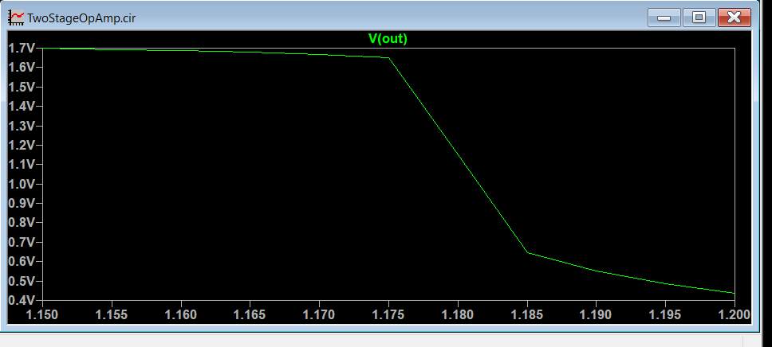
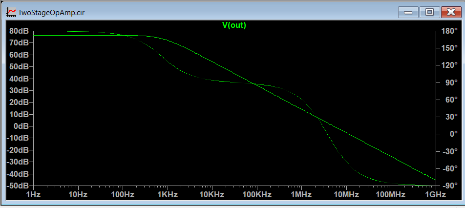
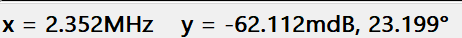
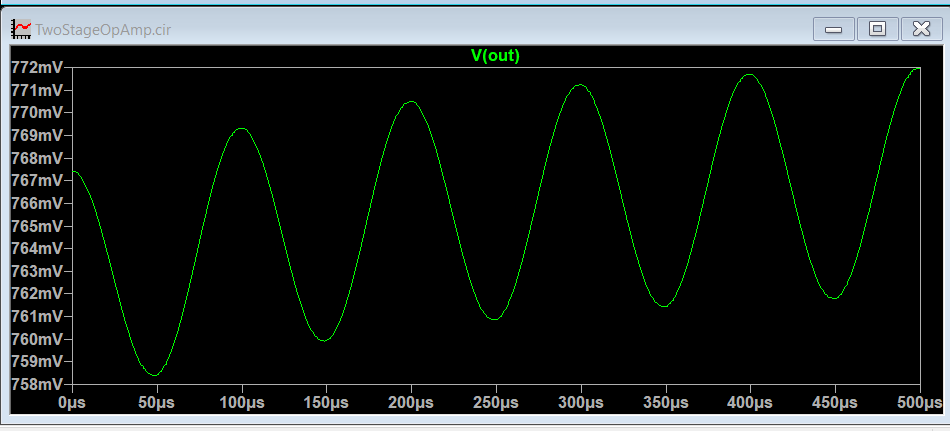

# Two-Stage CMOS Operational Amplifier Design

A transistor-level design and simulation of a two-stage CMOS Operational Amplifier using LTspice. The project explores differential amplification, current-mirror active loading, voltage gain, frequency response, bias optimization, and transient behavior using generic Level-1 MOSFET models.

## Project Overview

The objective of this project is to design and analyze a two-stage CMOS operational amplifier consisting of a differential input stage and a common-source second gain stage with Miller compensation.

The circuit is designed to investigate the relationship between transistor biasing, voltage gain, bandwidth, and transient response.

## Circuit Architecture

The operational amplifier consists of the following building blocks:

1. **Differential Input Stage (M1, M2):** Accepts differential input signals and converts the input voltage difference into a current difference.
2. **Current Mirror Active Load (M3, M4):** Provides active loading and converts the differential signal into a single-ended output.
3. **Tail Current Source (M5):** Establishes the bias current for the differential pair.
4. **Second Gain Stage (M6, M7):** Provides additional voltage amplification using a common-source configuration and active load.
5. **Miller Compensation Capacitor (Cc):** Introduces frequency compensation to investigate amplifier stability.
6. **Load Capacitor (CL):** Represents the capacitive load connected to the output.

## Design Parameters

| Parameter | Value |
|---|---:|
| Supply Voltage (VDD) | 1.8 V |
| Input Common-Mode Voltage | 0.9 V |
| Technology Model | Generic Level-1 MOSFET |
| NMOS Threshold Voltage | 0.45 V |
| PMOS Threshold Voltage | -0.45 V |
| Miller Compensation Capacitor (Cc) | 2 pF |
| Load Capacitance (CL) | 2 pF |
| PMOS Bias Voltage (VBPDC) | 1.1825 V |
| Tail Bias Voltage (VBN) | 0.72 V |

## Simulation Methodology

The circuit was analyzed using LTspice through three simulation techniques.

### 1. DC Operating Point Analysis

DC operating-point analysis was performed to evaluate the transistor bias conditions and establish a suitable output operating voltage.

A bias-voltage sweep was performed on the PMOS load to study the effect of bias voltage on the output DC level.

**Measured Output DC Voltage: 0.7674 V**



### 2. AC Frequency Response Analysis

AC analysis was performed to investigate the amplifier's frequency-dependent voltage gain and phase response.

The frequency response was analyzed over a range of 1 Hz to 1 GHz.

**Observed Results:**

| Parameter | Result |
|---|---:|
| Low-Frequency Gain | Approximately 78 dB |
| Unity-Gain Crossover Frequency | 2.352 MHz |
| Gain at Crossover | Approximately 0 dB |



**Unity-Gain Frequency Measurement:**

The gain crossover was measured using the LTspice waveform cursor.



### 3. Transient Response Analysis

Transient analysis was performed by applying a sinusoidal input signal and observing the output response over time.

**Simulation Conditions:**

- Input frequency: 10 kHz
- Input amplitude: 10 µV
- Simulation duration: 500 µs
- Measurement interval: 100–500 µs

**Measured Peak-to-Peak Voltages:**

| Parameter | Value |
|---|---:|
| Input Peak-to-Peak Voltage | 19.9676 µV |
| Output Peak-to-Peak Voltage | 12.0647 mV |
| Calculated Transient Voltage Gain | 604.3 V/V |
| Transient Voltage Gain | 55.62 dB |

The transient gain is calculated using:

\[
A_v = \frac{V_{out(pp)}}{V_{in(pp)}}
\]

\[
A_v(dB)=20\log_{10}(A_v)
\]



## Tools and Technologies

- LTspice 26.1.1
- SPICE circuit simulation
- CMOS analog circuit design
- MOSFET transistor modeling
- DC operating-point analysis
- AC frequency response analysis
- Transient analysis

## Repository Structure

```text
Two-Stage-CMOS-OpAmp/
│
├── README.md
│
├── LTspice/
│   └── TwoStageOpAmp.cir
│
├── Results/
│   ├── DC_Bias_Sweep.png
│   ├── AC_Frequency_Response.png
│   ├── Unity_Gain_Frequency.png
│   └── Transient_Response.png
│
└── Documentation/
    └── Design_Notes.md
```

## Limitations and Future Improvements

The current implementation uses generic Level-1 MOSFET models for educational simulation. It does not represent a verified foundry-specific CMOS process.

Potential improvements include:

- Implementing the design using an authorized 180 nm CMOS technology model.
- Optimizing transistor dimensions and bias currents.
- Improving unity-gain bandwidth.
- Performing proper loop-gain analysis to determine phase margin.
- Verifying transistor operating regions and saturation conditions.
- Evaluating slew rate, settling time, output swing, and power consumption.
- Investigating compensation under different capacitive loads.

## Learning Outcomes

Through this project, I explored:

- CMOS differential amplifier design.
- Current-mirror active loads.
- Two-stage voltage amplification.
- MOSFET biasing and operating points.
- Miller frequency compensation.
- Gain and bandwidth analysis.
- Transient response and voltage gain measurements.

---

**Simulation Environment:** LTspice 26.1.1  
**Project Domain:** Analog Electronics | CMOS Circuit Design | VLSI
